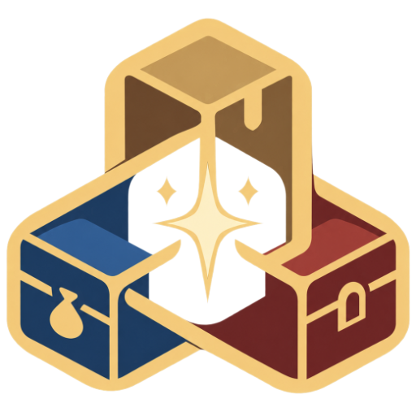
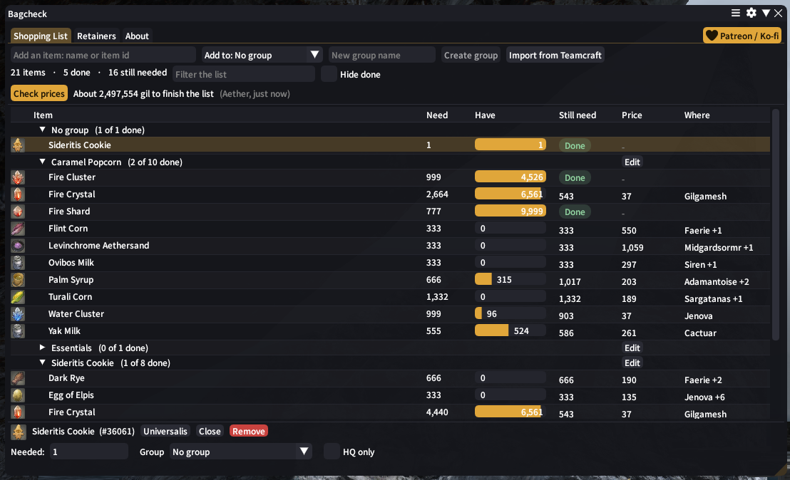
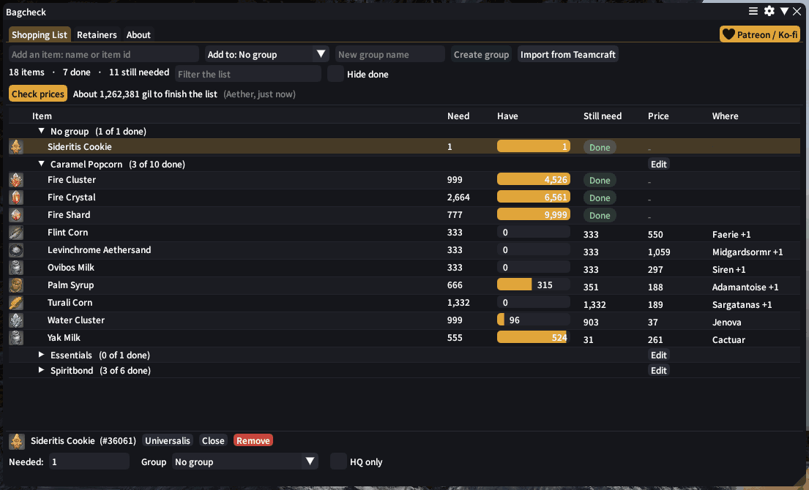

<p align="center"></p>

<h1 align="center">Bagcheck</h1>

<p align="center"><b>Know what you need, what you have, and where it's cheapest.</b></p>

<p align="center">
  <a href="https://github.com/EY4O/Bagcheck/blob/main/LICENSE"></a>
  <a href="https://github.com/EY4O/Bagcheck/commits/main"></a>
  <a href="https://ko-fi.com/looneth"></a>
</p>

Bagcheck is a shopping list and retainer tracker for FINAL FANTASY XIV crafters. Add what your crafts need, by hand,
from the right-click menu or straight from a [Teamcraft](https://ffxivteamcraft.com) list, and Bagcheck counts what you
already hold across your bags, crystals, saddlebag and retainers. It asks [Universalis](https://universalis.app) where
the rest is cheapest on your data centre and keeps an eye on your retainers' listings. Bagcheck keeps count; you do the
shopping. Open it in game with `/bagcheck`.



> **⚠ Bagcheck is a Dalamud plugin.** You need the game running through [XIVLauncher](https://goatcorp.github.io/)
> with Dalamud enabled.

---

## ✨ Key Features

- 📝 **Shopping List** — add items by search, from the right-click menu in your bags, or by pasting a Teamcraft list.
- 📋 **Teamcraft import** — raw materials are ticked for you, and re-pasting a list updates the amounts in its group.
- 🎒 **Need and have** — counts your bags, crystals, saddlebag and retainers, so you see exactly what's still missing.
- 🗂️ **Groups** — keep each craft's materials together, and pause a group you're not working on yet.
- 💰 **Price check** — the cheapest worlds on your data centre for everything you still need, with the market tax included.
- 🧾 **Cost to finish** — roughly what completing the whole list would cost, at a glance.
- 🏪 **NPC vendors** — shows when an NPC sells a material for less than the market board, and who and where.
- 👛 **Retainers** — each retainer's gil and listings, and which listings have been undercut on your home world.
- 🎨 **Theme** — a dark Bagcheck look with your choice of accent colour, or Dalamud's own style.

## 📸 Screenshots



**Import and price check** — paste a Teamcraft list into a new group, then **Check prices** finds the cheapest world
for everything still needed and adds up the cost to finish.

---

## 📦 Installation

### Option 1: **Custom plugin repository** (Recommended)

1. In game, open `/xlsettings`.
2. Under **Experimental → Custom Plugin Repositories**, add this URL and save:

   ```text
   https://ey4o.github.io/XIV-Plugins/repo.json
   ```

3. Open `/xlplugins`, then find and install **Bagcheck**.

### Option 2: **Manual Installation**

Build it from source (needs the [.NET 10 SDK](https://dotnet.microsoft.com/download)):

```bash
git clone https://github.com/EY4O/Bagcheck.git
```

```bash
dotnet build Bagcheck/Bagcheck.slnx -c Release
```

Then add `src/Bagcheck/bin/Release/Bagcheck.dll` under **`/xlsettings` → Experimental → Dev Plugin Locations** and
enable it in `/xlplugins`. More in [docs/DEVELOPMENT.md](docs/DEVELOPMENT.md).

## 🚀 Getting Started

1. Type `/bagcheck`. The welcome guide opens the first time; **Show me around** gives a four-step tour.
2. On the **Shopping List** tab, search for an item, right-click one in your bags and choose **Add to Shopping List**,
   or press **Import from Teamcraft** and paste a list.
3. Open your saddlebag, and your retainers at a summoning bell, so their contents count towards **Have**.
4. Press **Check prices** to see the cheapest world for each item under **Where**, and the cost to finish the list.
5. On the **Retainers** tab, open each retainer's market once, then press **Check prices** to see which listings
   have been undercut.

| Command | What it does |
| --- | --- |
| `/bagcheck` | Open Bagcheck |
| `/bagcheck settings` | Open the settings |
| `/bagcheck welcome` | Open the welcome guide |

---

## 📖 How It Works

<details>
<summary><b>🎒 What counts as "have"</b></summary>

- **Bags and crystals** are read live while you're logged in.
- **Saddlebag** contents are remembered from the last time you opened it, including the premium saddlebag.
- **Retainers** are remembered from the last time you opened each one at a summoning bell. Contents older than
  72 hours (adjustable in **Settings → Retainer counts expire after**) are still shown but no longer counted, since
  ventures or sales may have changed them.
- Hover over **Have** to see where your stock is and how old each count is.
- **HQ only** on an item counts and prices HQ alone; otherwise NQ and HQ both count.
- The same item in two active groups adds up both amounts; paused groups aren't counted.

Saddlebag and retainer counting can each be switched off in **Settings → What counts as held**.
</details>

<details>
<summary><b>📋 Teamcraft import</b></summary>

1. In Teamcraft, open your list and press **Copy as text** on a panel (the copy icon in its header).
2. In Bagcheck, press **Import from Teamcraft**, then **Paste**, and give the group a name.
3. Each line is marked **Raw material** (ticked), **Craftable** (unticked, tick it to buy it instead),
   **Not on market** or **Not recognised**.
4. **Add to list** creates the group. Later, **Update from Teamcraft** on that group shows what changed; items
   that dropped off the list are only removed if you tick that option.

Names are matched exactly, so Teamcraft needs to be set to the same language as your game.
</details>

<details>
<summary><b>💰 Prices and NPC vendors</b></summary>

- **Check prices** asks Universalis for current listings on your data centre for every item still needed. Done items
  and paused groups are skipped.
- **Price** is the average cost per unit for the cheapest way to fill what you need, with an estimated 5% market
  tax. **Where** names the world supplying most of it, with `+n` when more worlds are needed.
- Hover over a price for every world it's on, the price on your current world, the recent sales median, and how old
  the data is.
- When an NPC sells the item for less (read from the game's own shop data), **Where** says **NPC** and the tooltip
  says who and where. The total uses the NPC price. HQ-only entries never point at an NPC.
- If the data centre doesn't have enough listings, the world shows in amber and the total says how many aren't
  fully listed.

Prices move, so treat the total as a guide.
</details>

<details>
<summary><b>👛 Retainers</b></summary>

- Open a summoning bell: every retainer's name and gil is noted, in the game's order.
- Open a retainer's market: its listings are noted (item, quantity, price, total).
- **Check prices** compares each listing with the current listings on your home world and marks it **Lowest** or
  **Undercut by N**. Your own retainers never count as competition.
- Find a retainer by name, or an item by name or id, with the filter.
</details>

<details>
<summary><b>🛡️ Safety and data</b></summary>

- Bagcheck only reads what the game already shows you. It never clicks, opens windows, moves your character, buys,
  sells or sends anything to the game server.
- The only outside service it talks to is Universalis, and only when you press **Check prices**.
- Your list and settings live in Dalamud's plugin config; retainer and saddlebag records are kept in `retainers.json`
  and `stock.json` in Bagcheck's plugin config folder. Nothing leaves your PC.
</details>

---

## 🧪 Development

Building, tests and releasing are described in **[docs/DEVELOPMENT.md](docs/DEVELOPMENT.md)**.

## 🤝 Contributing

Issues and pull requests are welcome. Please run the test suite before opening a PR.

## 🙏 Credits

- [Dalamud](https://github.com/goatcorp/Dalamud) — the plugin framework Bagcheck runs in
- [Universalis](https://universalis.app) — market board data, gathered by players
- [FFXIV Teamcraft](https://ffxivteamcraft.com) — the crafting lists Bagcheck imports
- [FFXIVClientStructs](https://github.com/aers/FFXIVClientStructs) and [Lumina](https://github.com/NotAdam/Lumina) —
  game data and inventory reads

## ☕ Support

If Bagcheck has saved you some time or gil, you can support its development:

[](https://ko-fi.com/looneth)

## 📄 License

[MIT](LICENSE)
